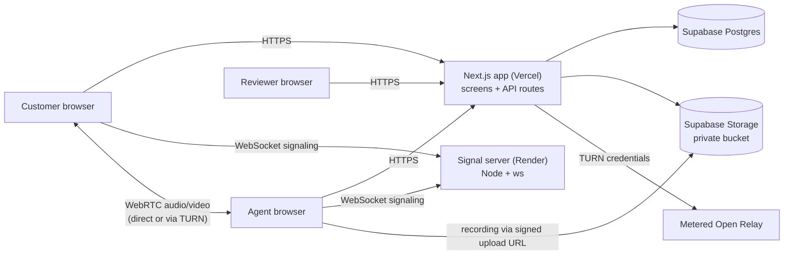

# SnapKYC Video

A video-KYC proof of concept. A customer gives consent and their location,
passes a (mock) SnapKYC identity check, and joins a live video call with an
agent. The agent takes a face snapshot and recommends approve or reject. A
**different** person watches the recording and makes the decision. Approval
issues a signed KYC token (JWT), shown as a QR code, that anyone can check on a
public page.

## Live demo

- App: <https://snap-kyc-video-fe6b.vercel.app>
- Check a token: <https://snap-kyc-video-fe6b.vercel.app/verify>
- Signal server health: <https://snapkyc-signal.onrender.com/health> (free
  tier: the first call after 15 idle minutes can take about a minute to connect)

Demo staff logins (password for all: `demo1234`):

| Username    | Role                | Use it to…                                          |
| ----------- | ------------------- | --------------------------------------------------- |
| `agent1`    | Agent               | run the call and recommend                          |
| `reviewer1` | Reviewer            | watch the recording and approve / reject            |
| `lead1`     | Agent **+** Reviewer | show maker-checker: may review others, never own call |

The customer needs no account. Any 12-digit dummy number works for the mock
SnapKYC check (e.g. `234567891234`); a number ending in `0000` simulates the
customer declining in the Aadhaar app.

### A full run

1. **Customer** (`/customer`, ideally on a phone or a second network): tick
   consent → allow location → _Use a sample number_ → _Verify with SnapKYC_ →
   _Join video call_.
2. **Agent** (`/login` as `agent1`): _Take call_ → _Join call_. Recording starts
   automatically once connected. Ask the 3 questions, _Take face snapshot_,
   then _End call & save recording_ → choose a recommendation → _Send to reviewer_.
3. **Reviewer** (`reviewer1`, in another browser or a private window — staff
   share one login cookie per browser): _Review_ → watch the recording → _Approve_.
4. The **customer** screen switches to the QR code and token. Scan it, or paste
   the token at `/verify`.

To see maker-checker block a decision, run the call as `lead1` and then try to
approve it as `lead1`: the server answers `403`.

### Call checks

- **Refresh:** refreshing either side mid-call puts it straight back into the
  same call.
- **Signaling drops:** once connected, video flows peer-to-peer, so if the
  WebSocket to the signal server drops (Render cuts them every few minutes),
  the call keeps running and the client quietly rejoins with `resume: true`.
  Nothing is renegotiated and the recording carries on. A second tab or device
  joining as the same person takes over the call, and the first one stops.
- **TURN only:** open the customer page as `/customer?relay=1` to allow only
  TURN relay paths. Once connected, the status line says _via TURN relay_
  (normally _direct peer-to-peer_), which proves the relay works on its own.
- **Failure:** if the camera is blocked, or no network path works within 25
  seconds, the call screen explains it and offers _Retry_.

## How the V-CIP rules are enforced

| Rule                   | Implementation                                                                                                                                                                                                                                  |
| ---------------------- | ----------------------------------------------------------------------------------------------------------------------------------------------------------------------------------------------------------------------------------------------- |
| Consent first          | `POST /api/customer/session` refuses to create a session without `consent: true`; the exact consent text and a server timestamp are stored.                                                                                                     |
| Customer is in India   | Browser geolocation (lat/lng/accuracy) is required and stored with a timestamp. An `in_india` flag (bounding-box check) is shown to the agent and reviewer.                                                                                      |
| Live call, not upload  | Two-way WebRTC. The signaling server only admits a holder of a 10-minute room token, which the API mints only for that session's customer and the agent who claimed it. One customer + one agent per room. TURN (Metered) for cross-network calls. |
| Call is recorded       | The agent's browser records the customer's video plus both voices and uploads straight to a private Supabase Storage bucket. The reviewer plays it through a 1-hour signed URL.                                                                  |
| Maker-checker          | `canDecide()` in [`apps/web/app/lib/rules.ts`](apps/web/app/lib/rules.ts) rejects the agent who ran the call (unit-tested), and the database has `check (reviewer_id <> agent_id)` as a second line of defence.                                    |

The agent also cannot recommend until a snapshot and a recording are saved, and
every state change is a conditional update (`... where status = <expected>`), so
two agents or two reviewers clicking at once cannot both succeed.

## Architecture



Session lifecycle:

```
consented → id_verified → in_call → pending_review → approved | rejected
 (customer)  (mock SnapKYC)  (agent claims)  (agent recommends)  (reviewer decides)
```

```
apps/web                 Next.js 16 app: all screens and API routes
  app/lib/rules.ts       pure business rules (maker-checker etc.) + tests
  app/lib/server/        auth, database, storage, tokens, mock SnapKYC
  app/api/               route handlers (every rule is checked here)
  app/lib/webrtc/        call hook, recorder hook
  supabase/schema.sql    table, constraints, storage bucket
apps/signal              WebSocket signaling server (JWT-gated rooms)
packages/types           shared signaling message types
```

Three separate secrets, so one leaking does not compromise the others:

| Secret             | Signs                                                                                     |
| ------------------ | ----------------------------------------------------------------------------------------- |
| `SIGNAL_SECRET`    | 10-minute room tokens `{ roomId, role }` — shared with the signal server                    |
| `AUTH_SECRET`      | httpOnly cookies for staff (8 h) and the customer's session (24 h)                         |
| `KYC_TOKEN_SECRET` | the KYC token: `{ name, kyc_status: "verified", sub, iss, iat, exp, jti }`, HS256, 30 days |

Checking a KYC token is stateless: signature + issuer + expiry, no database
lookup. The QR code links to `/verify#token=…`; the token sits in the URL
fragment, which browsers never send to a server.

## Run locally

Needs Node 22+ and a free [Supabase](https://supabase.com) project.

1. `npm install`
2. In Supabase → SQL editor, run [`apps/web/supabase/schema.sql`](apps/web/supabase/schema.sql)
   (creates the table and the private `kyc-media` bucket).
3. Copy `apps/web/.env.example` → `apps/web/.env` and
   `apps/signal/.env.example` → `apps/signal/.env`, then fill them in.
   `SIGNAL_SECRET` must be the same in both. Generate secrets with
   `node -e "console.log(require('crypto').randomBytes(32).toString('hex'))"`.
4. `npm run dev` — web on http://localhost:3000, signaling on ws://localhost:8080.
5. `npm test` — approval-rule and token tests.

Camera and location only work on `https://` or `localhost`, so to test with a
phone use the deployed URL. Without TURN credentials the app falls back to STUN,
which is fine on one network.

## Deploy (free tiers)

1. **Supabase** — create a project and run `schema.sql`.
2. **Signal server → Render** — _New → Blueprint_, pick this repo
   ([`render.yaml`](render.yaml)), set `SIGNAL_SECRET`.
3. **Web → Vercel** — import the repo, set _Root Directory_ to `apps/web`, add
   the variables from `apps/web/.env.example`, with
   `NEXT_PUBLIC_WS_URL=wss://<signal-app>.onrender.com`.
4. **TURN** — a free Metered Open Relay app gives `METERED_DOMAIN` and
   `METERED_TURN_API_KEY`.

Render's free tier sleeps after 15 minutes idle. The call screens ping
`/health` when they open, and the client keeps retrying the WebSocket, so the
first call after a pause can take about a minute to connect. An uptime
monitor hitting `/health` every 5 minutes keeps it awake. `render.yaml` only
redeploys the signal server when `apps/signal` or `packages/types` change,
because each redeploy restarts it.

## What is faked or simplified

- **SnapKYC is a mock** ([`mockSnapKyc.ts`](apps/web/app/lib/server/mockSnapKyc.ts),
  also exposed at `POST /api/mock-snapkyc`). A dummy number maps to one of five
  dummy people with a generated avatar as the "photo". The number itself is
  never stored, only a reference.
- **Staff login** is three hard-coded users with one password.
- **India check** is a bounding box on browser GPS, which a user can spoof. No
  IP check.
- **Face match** is manual: the reviewer sees the snapshot and the SnapKYC
  photo side by side.
- **Recording happens in the agent's browser.** If the agent refreshes or
  closes the tab mid-call, the recording so far is lost (a new one starts when
  they rejoin). If the customer reconnects, the recording restarts on the new
  connection, so the saved clip covers the call from the last reconnect. It
  records the customer's video and both voices, not the agent's video.
- **KYC token uses HS256**, so only this server can verify it, and there is no
  revocation list.
- No separate audit-log table; the session row keeps a timestamp for each step.

## What I would do next

- Sign tokens with ES256 and publish a JWKS endpoint so anyone can verify
  offline; then move toward W3C Verifiable Credentials / SD-JWT.
- Record on the server (an SFU such as LiveKit) so the recording does not
  depend on one browser, with both videos composited.
- Automated face match and liveness (e.g. BioChQ), plus an IP geolocation check.
- Append-only audit log, real staff auth (SSO + MFA), rate limiting, and a
  retention policy for recordings.
- Browser end-to-end tests (Playwright with fake media devices).
